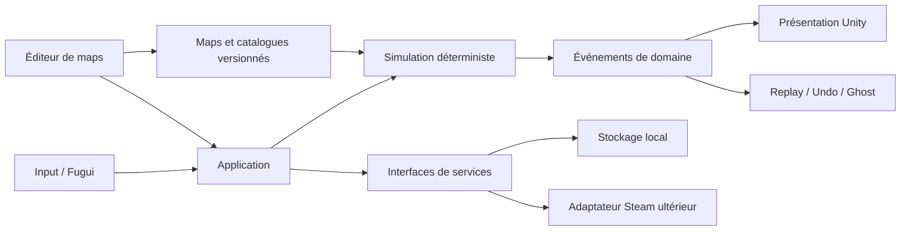

# Dodge From Light — architecture cible et feuille de route

## Principe directeur

La simulation est l’autorité. Unity affiche son résultat.

Une commande transforme un état logique en un nouvel état logique et retourne une suite ordonnée d’événements. Les animations, sons, VFX, UI, sauvegardes et intégrations Steam consomment ces événements ; ils ne décident jamais du résultat d’un puzzle.



## Dépendances autorisées

Le sens des dépendances est unique :

1. `Core` ne dépend de rien lié à Unity.
2. `Content` dépend de `Core`.
3. `Application` orchestre `Core` et les interfaces de services.
4. `Infrastructure` implémente stockage, import et services de plateforme.
5. `UnityPresentation` adapte les événements vers les GameObjects.
6. `FuguiUI` utilise les cas d’usage de `Application`.
7. `MapEditor` utilise `Application`, `Content` et les outils de présentation.

Steam, Fugui, les prefabs et les scènes ne sont jamais référencés depuis `Core`.

## Découpage cible

La structure précise pourra évoluer, mais les responsabilités restent séparées :

```text
Assets/DodgeFromLight/
  Core/
    Commands/
    Events/
    Model/
    Simulation/
    Systems/
  Content/
    Definitions/
    Catalogs/
    Validation/
  Application/
    Game/
    Maps/
    Profiles/
    Replays/
  Infrastructure/
    LegacyImport/
    LocalStorage/
    Platform/
  UnityPresentation/
    Animation/
    Audio/
    Camera/
    Grid/
    Views/
  FuguiUI/
    Screens/
    ViewModels/
  MapEditor/
    Commands/
    Tools/
    Validation/
  Tests/
    Core/
    Content/
    Import/
    Replays/
```

Chaque dossier fonctionnel important possède son assembly definition. Les tests du cœur compilent sans charger une scène Unity.

## Modèle logique

### `MapDefinition`

Contient les données immuables d’une révision :

- ID de map ;
- ID de révision ;
- version de schéma ;
- version de règles ;
- hash de contenu ;
- taille ;
- seed de gameplay si une règle en exige un ;
- cellules et paramètres typés ;
- marqueurs start/end ;
- ennemis et phases initiales ;
- routes de patrouille ;
- plateformes ;
- gears placés et loadout de départ ;
- capacités autorisées ;
- décor et environnement ;
- objectifs, par et tags ;
- métadonnées de création.

### `SimulationState`

Contient uniquement l’état nécessaire pour poursuivre une partie :

- index du tour ;
- position, orientation, statut et inventaire du héros ;
- état de l’ancre et des capacités ;
- position, orientation, phase, route et altérations des ennemis ;
- état des plateformes ;
- compteurs de pièges et gears posés ;
- cellules détruites ou modifiées ;
- seed et position du générateur déterministe, si nécessaire ;
- état de victoire ou défaite.

Il ne contient aucun `GameObject`, `Transform`, `Animator`, coroutine, callback ou asset Unity.

### `PlayerCommand`

Les commandes prévues sont explicites :

- déplacement cardinal ;
- attente ;
- rotation si elle reste une action distincte ;
- ramassage dans un slot ;
- utilisation d’un gear avec sa cible ;
- plantation ou activation de l’ancre ;
- impulsion ;
- saut ;
- activation d’un checkpoint.

Une commande invalide ne consomme jamais un tour.

### `DomainEvent`

La simulation décrit ce qui s’est produit :

- entité déplacée ou tournée ;
- gear ramassé, utilisé, posé ou détruit ;
- zone de danger modifiée ;
- altération ajoutée ou expirée ;
- cellule activée, détruite ou traversée ;
- entité attirée, poussée, étourdie ou figée ;
- héros détecté ;
- objectif atteint ;
- partie gagnée ou perdue.

La présentation peut ralentir, accélérer ou ignorer une animation sans changer l’état final.

## Résolution d’un tour

L’ordre définitif dépend des arbitrages listés dans la matrice de parité. Le pipeline cible est néanmoins fixe et observable :

1. valider la commande sur l’état courant ;
2. enregistrer le point d’undo ;
3. appliquer l’intention du joueur ;
4. résoudre départ, arrivée et déplacements forcés ;
5. faire progresser les cycles de début de tour ;
6. calculer les intentions des ennemis et plateformes ;
7. résoudre les micro-actions dans un ordre stable ;
8. recalculer les zones et effets après chaque micro-action pertinente ;
9. résoudre détection, chute, collision et objectif ;
10. décrémenter les durées de fin de tour ;
11. produire le nouvel état, les événements et le hash.

Les vues n’exécutent aucune de ces étapes. Elles ne font que lire les événements déjà résolus.

## Déterminisme, undo et replay

Les trois fonctions utilisent le même moteur :

- **Undo** restaure un snapshot compact ou rejoue les commandes jusqu’au point précédent.
- **Replay** repart de la même `MapDefinition` et applique le flux de commandes.
- **Ghost** interpole les événements du replay à la vitesse de présentation choisie.

Après chaque commande, un hash canonique de `SimulationState` peut être enregistré. Une divergence devient détectable au premier tour fautif.

Le hasard de gameplay est évité quand une règle fixe est possible. Lorsqu’il est indispensable, il passe par un générateur déterministe appartenant à l’état de simulation. `UnityEngine.Random` n’intervient jamais dans les règles.

## Format de map versionné

Les enums numériques legacy sont remplacés par des IDs stables, par exemple :

- `enemy.scout` ;
- `gear.grapple` ;
- `cell.needles` ;
- `decor.empty_tile_4`.

Le format sépare :

- une enveloppe versionnée ;
- la définition logique ;
- la décoration ;
- les métadonnées éditoriales ;
- l’aperçu binaire.

Une map publiée est immuable. Toute modification produit une nouvelle révision et un nouveau hash. Les scores et replays restent attachés à la révision qu’ils ont réellement utilisée.

Les migrations de schéma sont séquentielles : `v1 -> v2 -> v3`. Elles ne chargent jamais directement une ancienne map dans le runtime courant sans conversion validée.

## Éditeur

L’éditeur ne manipule plus directement les GameObjects ou les singletons du jeu. Chaque opération est une commande d’édition :

- peindre un sol ;
- changer un type de cellule ;
- placer ou supprimer un élément ;
- placer start/end ;
- ajouter un ennemi, un gear ou une plateforme ;
- modifier un paramètre ;
- éditer une route ;
- modifier décor, rotation, échelle et environnement.

Chaque commande sait :

- se valider ;
- s’appliquer ;
- s’annuler ;
- se rejouer ;
- marquer les validations à recalculer.

Le mode « tester » lance la même `MapDefinition` dans la même simulation que le jeu final. La validation vérifie au minimum les références, limites, routes, paramètres, capacités requises, start/end et compatibilité de version.

## Fugui

Fugui remplace progressivement les écrans uGUI, sans accéder directement aux règles.

Les écrans consomment des view models :

- menu principal ;
- sélection de campagne ;
- navigateur de maps ;
- HUD de jeu ;
- résultats et comparaison ;
- replays ;
- inventaire cosmétique ;
- éditeur ;
- paramètres et accessibilité.

Le HUD reçoit un état de lecture et envoie des intentions à `Application`. Il ne lit pas les singletons legacy et ne cherche pas les composants de scène.

La version et le mode d’intégration de Fugui seront figés au début de la phase UI. Fugui n’est pas présent dans le projet Unity actuel.

## Steam et absence de serveur de gameplay

Le jeu cible n’a pas besoin de NetSquare ou d’un serveur temps réel pour son gameplay solo.

Une interface `IPlatformServices` sépare les besoins :

- identité ;
- Workshop ;
- classements ;
- Cloud ;
- succès ;
- présence enrichie.

Un adaptateur local permet de développer et tester sans Steam. L’adaptateur Steam arrive après stabilisation du format des maps et replays.

Le Workshop stocke les packages de maps. Les classements reçoivent des références de révision et des métadonnées de replay. Un service propriétaire ne sera envisagé que si une contrainte Steam vérifiée ne couvre pas un besoin produit essentiel.

## Feuille de route

### Phase 0 — sécuriser et figer la source

Objectif : savoir exactement ce qui est conservé avant toute suppression.

Livrables :

- inventaire des assets et de leurs GUID ;
- inventaire hashé des 30 sources représentant 26 IDs de map et des trois sauvegardes `.dfls` ;
- identification des secrets, données privées, bases, builds et binaires qui ne sont pas des assets de jeu ;
- branche ou tag de référence legacy ;
- journal des décisions de règles.

Critère de sortie : chaque contenu de jeu possède un emplacement de référence et aucun nettoyage destructif n’est nécessaire pour poursuivre.

### Phase 1 — caractériser les règles

Objectif : transformer le legacy en spécification vérifiable.

Livrables :

- une micro-map par ennemi, gear, cellule et interaction importante ;
- résultats attendus tour par tour ;
- résolution des dix arbitrages de la matrice ;
- hashes ou snapshots d’états attendus ;
- liste des comportements volontairement corrigés.

Critère de sortie : une nouvelle implémentation peut être jugée sans lire son code.

### Phase 2 — créer le noyau déterministe

Objectif : obtenir un cœur C# indépendant de Unity.

Livrables :

- modèle de coordonnées, directions, cellules et état ;
- commandes et événements ;
- résolution d’un tour ;
- mouvement, collision, orientation, ligne de vue et victoire ;
- undo, replay et hash canonique ;
- assembly definitions et frontières de dépendances.

Critère de sortie : une map minimale se résout et se rejoue à l’identique sans scène Unity.

### Phase 3 — importer les maps legacy

Objectif : préserver le contenu existant tôt dans la migration.

Livrables :

- lecteur `grid.json` et `metadata.json` ;
- convertisseur vers le format versionné ;
- rapports d’erreurs ;
- détection des quatre conflits d’environnement sous des IDs partagés ;
- conversion non destructive des 30 sources, puis résolution éditoriale en 26 maps ou
  variantes visuelles explicitement identifiées.

Critère de sortie : chaque source legacy produit une définition cible relisible avec le
même hash, sans variante fusionnée ou supprimée silencieusement.

### Phase 4 — parité des cellules et du plateau

Objectif : porter le langage structurel des puzzles.

Livrables :

- dix types de cellules ;
- start/end et checkpoints ;
- plateformes ;
- éléments multi-cellules et blocage de vue ;
- cycles, déplacements forcés et destruction de cellules.

Critère de sortie : toutes les micro-maps de plateau passent leur scénario attendu.

### Phase 5 — parité des 12 ennemis

Objectif : porter chaque ennemi avec son identité complète.

Ordre conseillé :

1. Scoute, Keeper, Lizardman et Knight ;
2. Cyclops, Gloutton et Trap ;
3. Axe, Hammer, Catapult et Pillar ;
4. Thunderbird ;
5. collisions combinées et plateformes.

Critère de sortie : 12 ennemis sur 12 validés dans la matrice, y compris Pillar absent des maps actuelles.

### Phase 6 — capacités et 9 gears

Objectif : restaurer toutes les possibilités de puzzle.

Livrables :

- deux slots et ramassage ;
- neuf gears fonctionnels ;
- règles conçues pour Invisibility Cloak et Powder of Darkness ;
- saut, ancre et impulsion selon les arbitrages ;
- familier cosmétique hors simulation ;
- loadout déclaré par map.

Critère de sortie : 9 gears sur 9 et toutes les capacités retenues disposent de scénarios déterministes.

### Phase 7 — présentation Unity

Objectif : reconnecter les assets existants au nouveau moteur.

Livrables :

- registre ID vers prefab/VFX/audio ;
- construction de plateau ;
- vues du héros, des ennemis, gears et plateformes ;
- animation de la liste d’événements ;
- caméra, lisibilité des dangers et accélération ;
- mode présentation instantanée pour restart et replay rapide.

Critère de sortie : aucune coroutine ou animation ne peut changer le résultat logique.

### Phase 8 — UI Fugui et expérience solo

Objectif : rendre la boucle complète agréable.

Livrables :

- menus et navigation manette ;
- HUD de prédiction ;
- undo/restart instantanés ;
- résultats séparant réussite, actions et temps ;
- replays et fantômes locaux ;
- paramètres, accessibilité et lisibilité des couleurs ;
- inventaire cosmétique capable de gérer le catalogue existant.

Critère de sortie : campagne et replay sont utilisables sans UI legacy.

### Phase 9 — nouvel éditeur

Objectif : restaurer le cœur créatif du projet sur des fondations sûres.

Livrables :

- outils data-driven ;
- undo/redo complet ;
- validation en continu ;
- mode test sans export intermédiaire ;
- sauvegarde locale et package publiable ;
- recherche et filtres pour les 281 décors ;
- aperçu reproductible.

Critère de sortie : une map utilisant n’importe quel contenu conservé peut être créée, testée, fermée et rouverte sans perte.

### Phase 10 — campagne, progression et contenu éditorial

Objectif : construire la proposition commerciale.

Livrables :

- chapitres pédagogiques ;
- courbe de difficulté ;
- objectifs optionnels et par ;
- narration légère ;
- déblocage cosmétique non aléatoire ;
- sélection éditoriale de maps communautaires prête pour le lancement.

Critère de sortie : le jeu possède suffisamment de contenu officiel pour être acheté sans dépendre du Workshop.

### Phase 11 — Steam

Objectif : brancher la plateforme une fois les contrats stables.

Livrables :

- identité Steam ;
- Workshop versionné ;
- classements séparés actions/temps ;
- Cloud pour profil, maps locales et replays ;
- succès ;
- vérifications Steam Deck et contrôleur.

Critère de sortie : les services Steam peuvent être désactivés sans casser le mode solo local.

### Phase 12 — coupure legacy

Objectif : ne pas livrer deux architectures.

Livrables :

- suppression contrôlée des scripts, scènes et prefabs legacy remplacés ;
- retrait du serveur, PHP, launcher et anciennes UI de la distribution ;
- nettoyage des références et dépendances ;
- documentation de migration finale.

Critère de sortie : aucun système cible ne dépend d’une classe legacy et le contenu conservé est référencé par les nouveaux catalogues.

## Premier lot d’implémentation recommandé

Le premier lot de code, lorsqu’il sera explicitement autorisé, doit rester réduit :

1. créer les frontières d’assemblies et le namespace du nouveau cœur ;
2. définir coordonnées, direction, map minimale et état ;
3. implémenter `Move` et `Wait` ;
4. résoudre sol, vide, start et end ;
5. produire les événements et le hash d’état ;
6. permettre undo et replay de ce flux ;
7. importer une copie de `Tutorial/Level 1` vers le nouveau format ;
8. documenter les écarts sans modifier le legacy.

Ce lot est une tranche de migration, pas une réduction du contenu final.

## Règles de chantier

- Aucun nouveau système ne s’ajoute aux singletons globaux legacy.
- Aucun ID cible ne dépend de la valeur numérique d’un ancien enum.
- Aucun comportement de gameplay n’est piloté par une animation.
- Aucun appel Steam n’existe dans le cœur ou l’éditeur.
- Aucune map source n’est écrasée par une migration.
- Toute coexistence legacy/nouveau possède une date ou une phase de suppression.
- Une classe a une responsabilité claire et vit dans son propre fichier.
- Les fonctions de la nouvelle base respectent les conventions de documentation du projet.
- Les builds ne sont lancés qu’après autorisation explicite.
